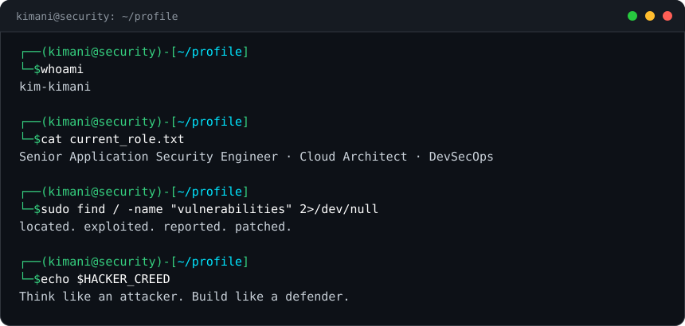

 

 

> I secure software and cloud infrastructure end to end. I break systems the way a real
> adversary would, prove the impact, show how it gets detected, then rebuild it hardened.
> Application security across web, mobile and APIs, cloud attack path analysis, and the
> automation that keeps it all defensible at scale.

`Kenya` &nbsp; `Offensive Security` &nbsp; `AppSec` &nbsp; `Cloud` &nbsp; `AI/LLM Security`

---

## Activity Logs

  

### TryHackMe

---

## Scope of Work

<table>
<tr>
<td valign="top" width="33%">

###  Offensive Security
- Black-box &amp; grey-box web application penetration testing
- Mobile application security assessment (Android / iOS, static &amp; dynamic analysis)
- REST &amp; GraphQL API security testing
- Network &amp; infrastructure penetration testing
- Adversary emulation &amp; red team operations (MITRE ATT&amp;CK)
- Vulnerability research &amp; N-day exploit development
- Active Directory &amp; internal network compromise
- Reconnaissance, OSINT &amp; external attack surface management

</td>
<td valign="top" width="33%">

###  Application Security
- Secure SDLC &amp; threat-driven design review
- Threat modeling (STRIDE / attack trees)
- SAST / DAST / SCA pipeline integration
- AuthN, AuthZ &amp; session management hardening
- Applied cryptography &amp; key management review
- Anti-phishing &amp; social engineering resilience
- AI / LLM security (prompt injection, OWASP LLM Top 10)
- Secure-by-design architecture

</td>
<td valign="top" width="33%">

###  Cloud &amp; DevSecOps (AWS)
- AWS security posture &amp; configuration review
- Cloud infrastructure architecture &amp; hardening
- IAM least-privilege &amp; privilege-escalation analysis
- Cloud attack-path &amp; lateral-movement mapping
- CI/CD pipeline security &amp; policy-as-code gates
- Detection engineering, logging &amp; honeypots
- Security automation &amp; custom tooling
- Container &amp; Kubernetes security (CIS benchmarks)

</td>
</tr>
</table>

---

## Tech Stack &amp; Tradecraft

**Offensive &amp; Application Security**

      
   

**Certifications**

![AWS](https://img.shields.io/badge/AWS-FF9900?style=flat-square&logo=data%3Aimage%2Fsvg%2Bxml%3Bbase64%2CPHN2ZyB4bWxucz0iaHR0cDovL3d3dy53My5vcmcvMjAwMC9zdmciIHdpZHRoPSIxZW0iIGhlaWdodD0iMWVtIiB2aWV3Qm94PSIwIDAgMjQgMjQiPjxwYXRoIGZpbGw9IndoaXRlIiBkPSJNNi43NjMgMTAuMDM2cS4wMDIuNDQ2LjA4OC43MWMuMDY0LjE3Ni4xNDQuMzY4LjI1Ni41NzZjLjA0LjA2My4wNTYuMTI3LjA1Ni4xODNxLjAwMi4xMi0uMTUyLjI0bC0uNTAzLjMzNWEuNC40IDAgMCAxLS4yMDguMDcycS0uMTItLjAwMi0uMjM5LS4xMTJhMi41IDIuNSAwIDAgMS0uMjg3LS4zNzVhNiA2IDAgMCAxLS4yNDgtLjQ3MXEtLjkzNCAxLjEwMS0yLjM0NyAxLjEwMWMtLjY3IDAtMS4yMDUtLjE5MS0xLjU5Ni0uNTc0cS0uNTg4LS41NzUtLjU5LTEuNTMzYzAtLjY3OC4yMzktMS4yMy43MjYtMS42NDRjLjQ4Ny0uNDE1IDEuMTMzLS42MjMgMS45NTUtLjYyM2MuMjcyIDAgLjU1MS4wMjQuODQ2LjA2NGMuMjk2LjA0LjYuMTA0LjkxOC4xNzZ2LS41ODNxLS4wMDEtLjkwOS0uMzc1LTEuMjc3Yy0uMjU1LS4yNDgtLjY4Ni0uMzY3LTEuMy0uMzY3Yy0uMjggMC0uNTY4LjAzMS0uODYzLjEwM3EtLjQ0My4xMDYtLjg2Mi4yNzJhMiAyIDAgMCAxLS4yOC4xMDRhLjUuNSAwIDAgMS0uMTI3LjAyM3EtLjE2OC4wMDItLjE2OC0uMjQ3di0uMzkxYzAtLjEyOC4wMTYtLjIyNC4wNTYtLjI4YS42LjYgMCAwIDEgLjIyNC0uMTY3YTQuNiA0LjYgMCAwIDEgMS4wMDUtLjM2YTQuOCA0LjggMCAwIDEgMS4yNDYtLjE1MWMuOTUgMCAxLjY0NC4yMTYgMi4wOTEuNjQ3cS42Ni42NDUuNjYyIDEuOTYzdjIuNTg2em0tMy4yNCAxLjIxNGMuMjYzIDAgLjUzNC0uMDQ4LjgyMi0uMTQ0YTEuOCAxLjggMCAwIDAgLjc1OC0uNTFhMS4zIDEuMyAwIDAgMCAuMjcyLS41MTJjLjA0Ny0uMTkxLjA4LS40MjMuMDgtLjY5NHYtLjMzNWE3IDcgMCAwIDAtLjczNS0uMTM2YTYgNiAwIDAgMC0uNzUtLjA0OGMtLjUzNSAwLS45MjYuMTA0LTEuMTkuMzJjLS4yNjMuMjE1LS4zOS41MTgtLjM5LjkxN2MwIC4zNzUuMDk1LjY1NS4yOTUuODQ2Yy4xOTEuMi40Ny4yOTYuODM4LjI5Nm02LjQxLjg2MmMtLjE0NCAwLS4yNC0uMDI0LS4zMDQtLjA4Yy0uMDY0LS4wNDgtLjEyLS4xNi0uMTY4LS4zMTFMNy41ODYgNS41NWExLjQgMS40IDAgMCAxLS4wNzItLjMyYzAtLjEyOC4wNjQtLjIuMTkxLS4yaC43ODNxLjIyNy0uMDAxLjMxLjA4Yy4wNjUuMDQ4LjExMy4xNi4xNi4zMTJsMS4zNDIgNS4yODRsMS4yNDUtNS4yODRxLjA1OC0uMjQuMTUxLS4zMTJhLjU1LjU1IDAgMCAxIC4zMi0uMDhoLjYzOGMuMTUyIDAgLjI1Ni4wMjUuMzIuMDhjLjA2My4wNDguMTIuMTYuMTUxLjMxMmwxLjI2MSA1LjM0OGwxLjM4MS01LjM0OHEuMDc0LS4yNC4xNi0uMzEyYS41Mi41MiAwIDAgMSAuMzExLS4wOGguNzQzYy4xMjcgMCAuMi4wNjUuMi4yYzAgLjA0LS4wMDkuMDgtLjAxNy4xMjhhMSAxIDAgMCAxLS4wNTYuMmwtMS45MjMgNi4xN3EtLjA3Mi4yNC0uMTY4LjMxMWEuNS41IDAgMCAxLS4zMDMuMDhoLS42ODdjLS4xNTEgMC0uMjU1LS4wMjQtLjMyLS4wOGMtLjA2My0uMDU2LS4xMTktLjE2LS4xNS0uMzJsLTEuMjM4LTUuMTQ4bC0xLjIzIDUuMTRjLS4wNC4xNi0uMDg3LjI2NC0uMTUuMzJjLS4wNjUuMDU2LS4xNzcuMDgtLjMyLjA4em0xMC4yNTYuMjE1Yy0uNDE1IDAtLjgzLS4wNDgtMS4yMjktLjE0M2MtLjM5OS0uMDk2LS43MS0uMi0uOTE4LS4zMmMtLjEyOC0uMDcxLS4yMTUtLjE1MS0uMjQ3LS4yMjNhLjYuNiAwIDAgMS0uMDQ4LS4yMjR2LS40MDdjMC0uMTY3LjA2NC0uMjQ3LjE4My0uMjQ3cS4wNzIgMCAuMTQ0LjAyNGMuMDQ4LjAxNi4xMi4wNDguMi4wOHEuNDA4LjE4MS44NzguMjc5Yy4zMTkuMDY0LjYzLjA5Ni45NS4wOTZjLjUwMiAwIC44OTQtLjA4OCAxLjE2NS0uMjY0YS44Ni44NiAwIDAgMCAuNDE1LS43NThhLjc4Ljc4IDAgMCAwLS4yMTUtLjU1OWMtLjE0NC0uMTUxLS40MTYtLjI4Ny0uODA3LS40MTVsLTEuMTU3LS4zNmMtLjU4My0uMTgzLTEuMDE0LS40NTQtMS4yNzctLjgxM2ExLjkgMS45IDAgMCAxLS40LTEuMTU4cTAtLjUwMi4yMTYtLjg4NmMuMTQ0LS4yNTUuMzM1LS40NzkuNTc1LS42NTRjLjI0LS4xODQuNTEtLjMyLjgzLS40MTVjLjMyLS4wOTYuNjU1LS4xMzYgMS4wMDYtLjEzNmMuMTc1IDAgLjM1OS4wMDguNTM1LjAzMmMuMTgzLjAyNC4zNS4wNTYuNTE4LjA4OHEuMjQuMDU4LjQ1NS4xMjdxLjIxNi4wNzIuMzM2LjE0NGEuNy43IDAgMCAxIC4yNC4yYS40My40MyAwIDAgMSAuMDcxLjI2M3YuMzc1cS0uMDAyLjI1NC0uMTg0LjI1NmEuOC44IDAgMCAxLS4zMDMtLjA5NmEzLjY1IDMuNjUgMCAwIDAtMS41MzItLjMxMWMtLjQ1NSAwLS44MTUuMDcxLTEuMDYyLjIyM3MtLjM3NS4zODMtLjM3NS43MWMwIC4yMjQuMDguNDE2LjI0LjU2N2MuMTU5LjE1Mi40NTQuMzA0Ljg3Ny40NGwxLjEzNC4zNThjLjU3NC4xODQuOTkuNDQgMS4yMzcuNzY3cy4zNjcuNzAyLjM2NyAxLjExN2MwIC4zNDMtLjA3Mi42NTUtLjIwNy45MjZhMi4yIDIuMiAwIDAgMS0uNTgzLjcwM2MtLjI0OC4yLS41NDMuMzQzLS44ODYuNDQ3Yy0uMzYuMTExLS43MzQuMTY3LTEuMTQyLjE2N20xLjUwOSAzLjg4Yy0yLjYyNiAxLjk0LTYuNDQyIDIuOTY5LTkuNzIyIDIuOTY5Yy00LjU5OCAwLTguNzQtMS43LTExLjg3LTQuNTI2Yy0uMjQ3LS4yMjMtLjAyNC0uNTI3LjI3Mi0uMzUxYzMuMzg0IDEuOTYzIDcuNTU5IDMuMTUzIDExLjg3NyAzLjE1M2MyLjkxNCAwIDYuMTE0LS42MDcgOS4wNi0xLjg1MmMuNDM5LS4yLjgxNC4yODcuMzgzLjYwN20xLjA5NC0xLjI0NmMtLjMzNi0uNDMtMi4yMi0uMjA3LTMuMDc0LS4xMDNjLS4yNTUuMDMyLS4yOTUtLjE5Mi0uMDYzLS4zNmMxLjUtMS4wNTMgMy45NjctLjc1IDQuMjU0LS4zOTljLjI4Ny4zNi0uMDggMi44MjYtMS40ODUgNC4wMDdjLS4yMTUuMTg0LS40MjMuMDg4LS4zMjctLjE1MWMuMzItLjc5IDEuMDMtMi41Ny42OTUtMi45OTQiLz48L3N2Zz4%3D&logoColor=white)     
  

**Cloud &amp; Infrastructure**

![AWS](https://img.shields.io/badge/AWS-FF9900?style=flat-square&logo=data%3Aimage%2Fsvg%2Bxml%3Bbase64%2CPHN2ZyB4bWxucz0iaHR0cDovL3d3dy53My5vcmcvMjAwMC9zdmciIHdpZHRoPSIxZW0iIGhlaWdodD0iMWVtIiB2aWV3Qm94PSIwIDAgMjQgMjQiPjxwYXRoIGZpbGw9IndoaXRlIiBkPSJNNi43NjMgMTAuMDM2cS4wMDIuNDQ2LjA4OC43MWMuMDY0LjE3Ni4xNDQuMzY4LjI1Ni41NzZjLjA0LjA2My4wNTYuMTI3LjA1Ni4xODNxLjAwMi4xMi0uMTUyLjI0bC0uNTAzLjMzNWEuNC40IDAgMCAxLS4yMDguMDcycS0uMTItLjAwMi0uMjM5LS4xMTJhMi41IDIuNSAwIDAgMS0uMjg3LS4zNzVhNiA2IDAgMCAxLS4yNDgtLjQ3MXEtLjkzNCAxLjEwMS0yLjM0NyAxLjEwMWMtLjY3IDAtMS4yMDUtLjE5MS0xLjU5Ni0uNTc0cS0uNTg4LS41NzUtLjU5LTEuNTMzYzAtLjY3OC4yMzktMS4yMy43MjYtMS42NDRjLjQ4Ny0uNDE1IDEuMTMzLS42MjMgMS45NTUtLjYyM2MuMjcyIDAgLjU1MS4wMjQuODQ2LjA2NGMuMjk2LjA0LjYuMTA0LjkxOC4xNzZ2LS41ODNxLS4wMDEtLjkwOS0uMzc1LTEuMjc3Yy0uMjU1LS4yNDgtLjY4Ni0uMzY3LTEuMy0uMzY3Yy0uMjggMC0uNTY4LjAzMS0uODYzLjEwM3EtLjQ0My4xMDYtLjg2Mi4yNzJhMiAyIDAgMCAxLS4yOC4xMDRhLjUuNSAwIDAgMS0uMTI3LjAyM3EtLjE2OC4wMDItLjE2OC0uMjQ3di0uMzkxYzAtLjEyOC4wMTYtLjIyNC4wNTYtLjI4YS42LjYgMCAwIDEgLjIyNC0uMTY3YTQuNiA0LjYgMCAwIDEgMS4wMDUtLjM2YTQuOCA0LjggMCAwIDEgMS4yNDYtLjE1MWMuOTUgMCAxLjY0NC4yMTYgMi4wOTEuNjQ3cS42Ni42NDUuNjYyIDEuOTYzdjIuNTg2em0tMy4yNCAxLjIxNGMuMjYzIDAgLjUzNC0uMDQ4LjgyMi0uMTQ0YTEuOCAxLjggMCAwIDAgLjc1OC0uNTFhMS4zIDEuMyAwIDAgMCAuMjcyLS41MTJjLjA0Ny0uMTkxLjA4LS40MjMuMDgtLjY5NHYtLjMzNWE3IDcgMCAwIDAtLjczNS0uMTM2YTYgNiAwIDAgMC0uNzUtLjA0OGMtLjUzNSAwLS45MjYuMTA0LTEuMTkuMzJjLS4yNjMuMjE1LS4zOS41MTgtLjM5LjkxN2MwIC4zNzUuMDk1LjY1NS4yOTUuODQ2Yy4xOTEuMi40Ny4yOTYuODM4LjI5Nm02LjQxLjg2MmMtLjE0NCAwLS4yNC0uMDI0LS4zMDQtLjA4Yy0uMDY0LS4wNDgtLjEyLS4xNi0uMTY4LS4zMTFMNy41ODYgNS41NWExLjQgMS40IDAgMCAxLS4wNzItLjMyYzAtLjEyOC4wNjQtLjIuMTkxLS4yaC43ODNxLjIyNy0uMDAxLjMxLjA4Yy4wNjUuMDQ4LjExMy4xNi4xNi4zMTJsMS4zNDIgNS4yODRsMS4yNDUtNS4yODRxLjA1OC0uMjQuMTUxLS4zMTJhLjU1LjU1IDAgMCAxIC4zMi0uMDhoLjYzOGMuMTUyIDAgLjI1Ni4wMjUuMzIuMDhjLjA2My4wNDguMTIuMTYuMTUxLjMxMmwxLjI2MSA1LjM0OGwxLjM4MS01LjM0OHEuMDc0LS4yNC4xNi0uMzEyYS41Mi41MiAwIDAgMSAuMzExLS4wOGguNzQzYy4xMjcgMCAuMi4wNjUuMi4yYzAgLjA0LS4wMDkuMDgtLjAxNy4xMjhhMSAxIDAgMCAxLS4wNTYuMmwtMS45MjMgNi4xN3EtLjA3Mi4yNC0uMTY4LjMxMWEuNS41IDAgMCAxLS4zMDMuMDhoLS42ODdjLS4xNTEgMC0uMjU1LS4wMjQtLjMyLS4wOGMtLjA2My0uMDU2LS4xMTktLjE2LS4xNS0uMzJsLTEuMjM4LTUuMTQ4bC0xLjIzIDUuMTRjLS4wNC4xNi0uMDg3LjI2NC0uMTUuMzJjLS4wNjUuMDU2LS4xNzcuMDgtLjMyLjA4em0xMC4yNTYuMjE1Yy0uNDE1IDAtLjgzLS4wNDgtMS4yMjktLjE0M2MtLjM5OS0uMDk2LS43MS0uMi0uOTE4LS4zMmMtLjEyOC0uMDcxLS4yMTUtLjE1MS0uMjQ3LS4yMjNhLjYuNiAwIDAgMS0uMDQ4LS4yMjR2LS40MDdjMC0uMTY3LjA2NC0uMjQ3LjE4My0uMjQ3cS4wNzIgMCAuMTQ0LjAyNGMuMDQ4LjAxNi4xMi4wNDguMi4wOHEuNDA4LjE4MS44NzguMjc5Yy4zMTkuMDY0LjYzLjA5Ni45NS4wOTZjLjUwMiAwIC44OTQtLjA4OCAxLjE2NS0uMjY0YS44Ni44NiAwIDAgMCAuNDE1LS43NThhLjc4Ljc4IDAgMCAwLS4yMTUtLjU1OWMtLjE0NC0uMTUxLS40MTYtLjI4Ny0uODA3LS40MTVsLTEuMTU3LS4zNmMtLjU4My0uMTgzLTEuMDE0LS40NTQtMS4yNzctLjgxM2ExLjkgMS45IDAgMCAxLS40LTEuMTU4cTAtLjUwMi4yMTYtLjg4NmMuMTQ0LS4yNTUuMzM1LS40NzkuNTc1LS42NTRjLjI0LS4xODQuNTEtLjMyLjgzLS40MTVjLjMyLS4wOTYuNjU1LS4xMzYgMS4wMDYtLjEzNmMuMTc1IDAgLjM1OS4wMDguNTM1LjAzMmMuMTgzLjAyNC4zNS4wNTYuNTE4LjA4OHEuMjQuMDU4LjQ1NS4xMjdxLjIxNi4wNzIuMzM2LjE0NGEuNy43IDAgMCAxIC4yNC4yYS40My40MyAwIDAgMSAuMDcxLjI2M3YuMzc1cS0uMDAyLjI1NC0uMTg0LjI1NmEuOC44IDAgMCAxLS4zMDMtLjA5NmEzLjY1IDMuNjUgMCAwIDAtMS41MzItLjMxMWMtLjQ1NSAwLS44MTUuMDcxLTEuMDYyLjIyM3MtLjM3NS4zODMtLjM3NS43MWMwIC4yMjQuMDguNDE2LjI0LjU2N2MuMTU5LjE1Mi40NTQuMzA0Ljg3Ny40NGwxLjEzNC4zNThjLjU3NC4xODQuOTkuNDQgMS4yMzcuNzY3cy4zNjcuNzAyLjM2NyAxLjExN2MwIC4zNDMtLjA3Mi42NTUtLjIwNy45MjZhMi4yIDIuMiAwIDAgMS0uNTgzLjcwM2MtLjI0OC4yLS41NDMuMzQzLS44ODYuNDQ3Yy0uMzYuMTExLS43MzQuMTY3LTEuMTQyLjE2N20xLjUwOSAzLjg4Yy0yLjYyNiAxLjk0LTYuNDQyIDIuOTY5LTkuNzIyIDIuOTY5Yy00LjU5OCAwLTguNzQtMS43LTExLjg3LTQuNTI2Yy0uMjQ3LS4yMjMtLjAyNC0uNTI3LjI3Mi0uMzUxYzMuMzg0IDEuOTYzIDcuNTU5IDMuMTUzIDExLjg3NyAzLjE1M2MyLjkxNCAwIDYuMTE0LS42MDcgOS4wNi0xLjg1MmMuNDM5LS4yLjgxNC4yODcuMzgzLjYwN20xLjA5NC0xLjI0NmMtLjMzNi0uNDMtMi4yMi0uMjA3LTMuMDc0LS4xMDNjLS4yNTUuMDMyLS4yOTUtLjE5Mi0uMDYzLS4zNmMxLjUtMS4wNTMgMy45NjctLjc1IDQuMjU0LS4zOTljLjI4Ny4zNi0uMDggMi44MjYtMS40ODUgNC4wMDdjLS4yMTUuMTg0LS40MjMuMDg4LS4zMjctLjE1MWMuMzItLjc5IDEuMDMtMi41Ny42OTUtMi45OTQiLz48L3N2Zz4%3D&logoColor=white)    

**DevSecOps &amp; Automation**

    
  

**Hardware &amp; RF**

    
  

**Languages**

    

**AI &amp; LLM**

   ![ChatGPT](https://img.shields.io/badge/ChatGPT-74AA9C?style=flat-square&logo=data%3Aimage%2Fsvg%2Bxml%3Bbase64%2CPHN2ZyB4bWxucz0iaHR0cDovL3d3dy53My5vcmcvMjAwMC9zdmciIHdpZHRoPSIxZW0iIGhlaWdodD0iMWVtIiB2aWV3Qm94PSIwIDAgMjQgMjQiPjxwYXRoIGZpbGw9IndoaXRlIiBkPSJNMjIuMjgyIDkuODIxYTYgNiAwIDAgMC0uNTE2LTQuOTFhNi4wNSA2LjA1IDAgMCAwLTYuNTEtMi45QTYuMDY1IDYuMDY1IDAgMCAwIDQuOTgxIDQuMThhNiA2IDAgMCAwLTMuOTk4IDIuOWE2LjA1IDYuMDUgMCAwIDAgLjc0MyA3LjA5N2E1Ljk4IDUuOTggMCAwIDAgLjUxIDQuOTExYTYuMDUgNi4wNSAwIDAgMCA2LjUxNSAyLjlBNiA2IDAgMCAwIDEzLjI2IDI0YTYuMDYgNi4wNiAwIDAgMCA1Ljc3Mi00LjIwNmE2IDYgMCAwIDAgMy45OTctMi45YTYuMDYgNi4wNiAwIDAgMC0uNzQ3LTcuMDczTTEzLjI2IDIyLjQzYTQuNDggNC40OCAwIDAgMS0yLjg3Ni0xLjA0bC4xNDEtLjA4MWw0Ljc3OS0yLjc1OGEuOC44IDAgMCAwIC4zOTItLjY4MXYtNi43MzdsMi4wMiAxLjE2OGEuMDcuMDcgMCAwIDEgLjAzOC4wNTJ2NS41ODNhNC41MDQgNC41MDQgMCAwIDEtNC40OTQgNC40OTRNMy42IDE4LjMwNGE0LjQ3IDQuNDcgMCAwIDEtLjUzNS0zLjAxNGwuMTQyLjA4NWw0Ljc4MyAyLjc1OWEuNzcuNzcgMCAwIDAgLjc4IDBsNS44NDMtMy4zNjl2Mi4zMzJhLjA4LjA4IDAgMCAxLS4wMzMuMDYyTDkuNzQgMTkuOTVhNC41IDQuNSAwIDAgMS02LjE0LTEuNjQ2TTIuMzQgNy44OTZhNC41IDQuNSAwIDAgMSAyLjM2Ni0xLjk3M1YxMS42YS43Ny43NyAwIDAgMCAuMzg4LjY3N2w1LjgxNSAzLjM1NGwtMi4wMiAxLjE2OGEuMDguMDggMCAwIDEtLjA3MSAwbC00LjgzLTIuNzg2QTQuNTA0IDQuNTA0IDAgMCAxIDIuMzQgNy44NzJ6bTE2LjU5NyAzLjg1NWwtNS44MzMtMy4zODdMMTUuMTE5IDcuMmEuMDguMDggMCAwIDEgLjA3MSAwbDQuODMgMi43OTFhNC40OTQgNC40OTQgMCAwIDEtLjY3NiA4LjEwNXYtNS42NzhhLjc5Ljc5IDAgMCAwLS40MDctLjY2N20yLjAxLTMuMDIzbC0uMTQxLS4wODVsLTQuNzc0LTIuNzgyYS43OC43OCAwIDAgMC0uNzg1IDBMOS40MDkgOS4yM1Y2Ljg5N2EuMDcuMDcgMCAwIDEgLjAyOC0uMDYxbDQuODMtMi43ODdhNC41IDQuNSAwIDAgMSA2LjY4IDQuNjZ6bS0xMi42NCA0LjEzNWwtMi4wMi0xLjE2NGEuMDguMDggMCAwIDEtLjAzOC0uMDU3VjYuMDc1YTQuNSA0LjUgMCAwIDEgNy4zNzUtMy40NTNsLS4xNDIuMDhMOC43MDQgNS40NmEuOC44IDAgMCAwLS4zOTMuNjgxem0xLjA5Ny0yLjM2NWwyLjYwMi0xLjVsMi42MDcgMS41djIuOTk5bC0yLjU5NyAxLjVsLTIuNjA3LTEuNVoiLz48L3N2Zz4%3D&logoColor=white)

**Recon Hits**

---

## Connect

  

